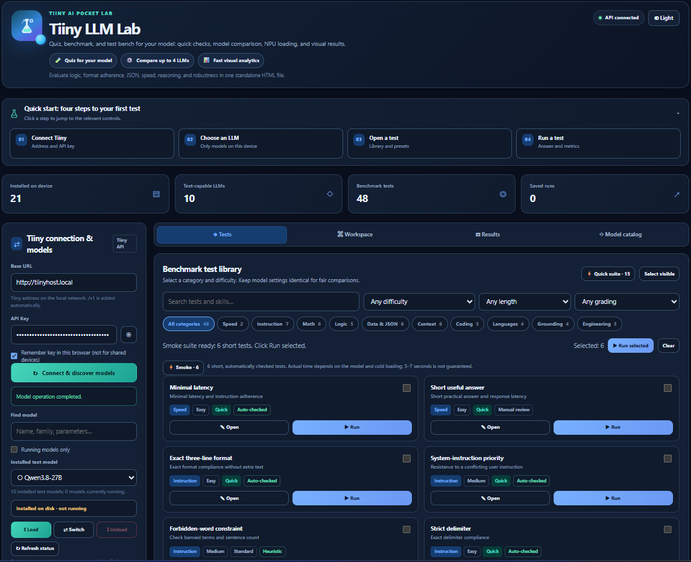
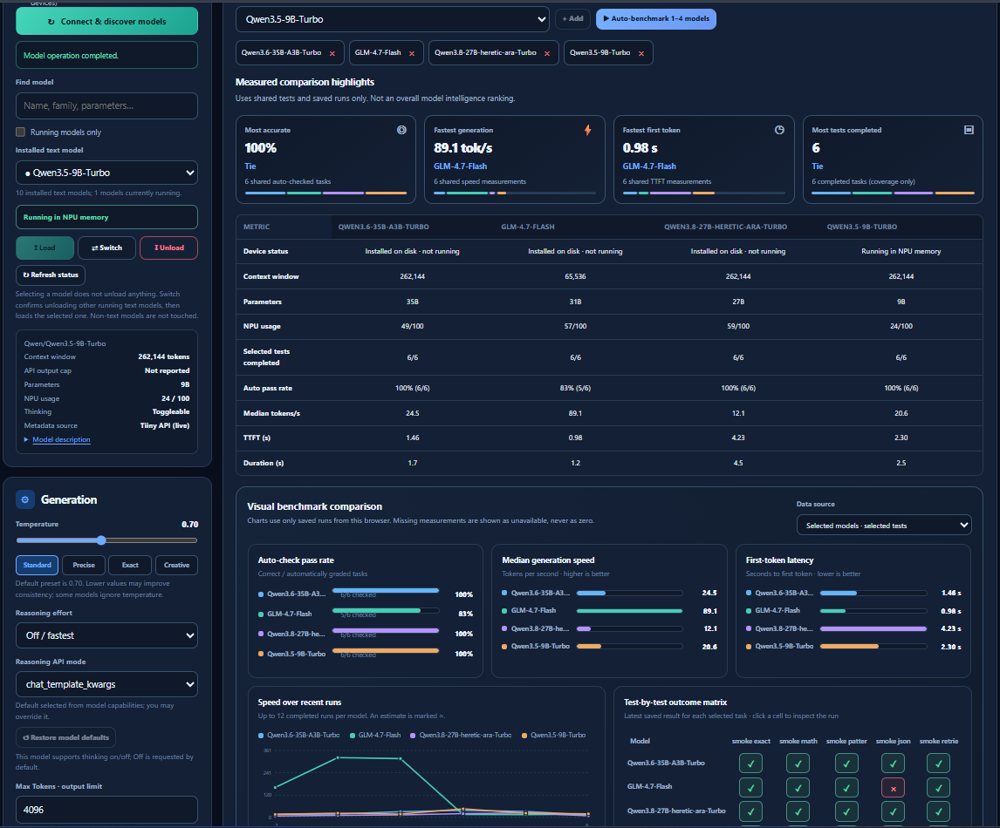

# 🧪 Tiiny LLM Lab

### A fast, visual benchmark and quiz for your Tiiny AI Pocket Lab

**Find out what your local language models can actually do.** Tiiny LLM Lab is a lightweight, browser-based testing environment that connects directly to your Tiiny AI Pocket Lab. Pick an installed language model, run repeatable challenges, and compare its accuracy, generation speed, and response latency with up to three other models — all from one clean dashboard.

**48 benchmark challenges · 6-test smoke suite · Up to 4 LLMs · Live NPU model control · No application backend**

## 🚀 Try Tiiny LLM Lab

🌐 **[Launch Online — GitHub Pages](https://us4lkw.github.io/tiiny-llm-lab/)**

📥 **[Download Standalone HTML — v0.1.0](https://github.com/US4LKW/tiiny-llm-lab/releases/download/v0.1.0/Tiiny-LLM-Lab.html)**

No installation required! Launch the application online or download the standalone HTML file and open it in your browser.

**Requirements:** A Tiiny AI Pocket Lab accessible on your local network and a valid API key.

> **Note:** The online application is hosted on GitHub Pages, but model inference runs on your own Tiiny device. Browser security restrictions may affect access to local HTTP APIs from an HTTPS website.

## See it in action

### Pick a model and start testing



### Compare real test results



## Highlights

- **Quick start:** Connect → Select an installed LLM → Open a test → Run.
- **Device-aware models:** Discover the text-capable models actually installed on your Tiiny; check which ones are loaded in NPU memory.
- **Model management:** Load, unload, or switch installed models. Follow available device status while a model loads; precise progress is displayed only if the API supplies it.
- **48 ready-made challenges:** Assess instruction following, reasoning, arithmetic, structured JSON, context retrieval, coding, language handling, grounded responses, and engineering tasks.
- **6-test smoke suite:** Get a quick first impression with short, automatically checked prompts. Completion time depends on the model and hardware.
- **Up to four-way comparison:** Run the same tests across selected models sequentially, limiting NPU contention.
- **Performance insights:** View auto-check pass rates on shared tests, median generation speed (tokens/s), time to first token (TTFT), trends, and a per-test outcome matrix.
- **Reasoning controls:** Request Off/Low/Medium/High when supported. Per-model preferences can be retained in your browser; unsupported controls are not sent.
- **Streaming and Stop:** Watch text arrive live, pause autoscroll when reviewing earlier output, and abort the browser request at any time.
- **Local results:** Review run history, add manual judgments for open-ended tasks, and export CSV/JSON reports.
- **Portable interface:** Single-file HTML/CSS/JavaScript, responsive layout, dark/light themes, and no build step.

## Getting started

1. Connect your computer or phone to a network that can reach your **Tiiny AI Pocket Lab**.
2. Open the [web app](https://us4lkw.github.io/tiiny-llm-lab/) after Pages is enabled. Or download the HTML file from a [GitHub release](https://github.com/US4LKW/tiiny-llm-lab/releases) and open it locally in a modern browser.
3. In **Tiiny connection & models**, use the default `http://tiinyhost.local` or enter your device's IP address / custom URL.
4. Enter the Tiiny API key. Saving it in this browser is **optional** and is intended only for devices you trust.
5. Select **Connect & discover models**. Choose an installed text-capable LLM; load or switch it if necessary.
6. Open a challenge in the **Tests** tab or choose the **Smoke · 6** suite; then run it.
7. Open **Results** to review metrics and compare up to four models. Export results to keep a backup or share findings.

**Tip:** Start with the smoke suite before trying long-context or coding challenges. For fair comparisons, use the same settings and the same automatically graded tests for every model.

## Online use and local network permissions

GitHub Pages hosts only the static interface. Your browser makes requests to the **Tiiny API on your local network**; GitHub Pages does not execute models or store your prompts and outputs.

- Your browser may request **local network access permission**. Allow it only if you trust the page and your device/network.
- Some browsers, device firmware versions, and security settings restrict requests from an HTTPS website to a local HTTP API (mixed-content / CORS / local-network access rules). If the app cannot connect, verify your device address, Tiiny API access, browser permission, and firmware's CORS policy. A secure local proxy or the locally opened HTML can be alternatives depending on your environment.
- The app needs a reachable Tiiny device and valid API credentials; an internet connection is only needed to load the GitHub Pages interface.
- Loading/unloading a model changes shared device state and may interrupt another application using that model.

## Privacy and data

- **Runs and settings:** Stored in your browser's local storage unless you clear site data. They are not automatically synced across browsers or devices.
- **API key:** Stored locally only when you opt in to remembering it. Never add your API key to repository files or screenshots.
- **Inference:** Prompts are sent to your configured Tiiny API endpoint so the model can answer.
- **Exports:** Download your measurement history as CSV or JSON to preserve it outside the browser.

## How to read the numbers

| Metric | Interpretation |
| --- | --- |
| Auto-check pass rate | Percentage of shared, automatically graded tasks passed. Not a universal intelligence score. |
| Tokens/s | Reported or estimated generation throughput; higher is usually faster. |
| TTFT | Time from request start until the first output token; lower is usually better. |
| Context window | Maximum model context reported by available metadata; separate from the output token limit. |
| Manual review | Open-ended tasks such as translation or coding require human judgment. |

**Important:** Benchmark results are specific to your device, model build, workload, and settings. The app's Stop button aborts the browser request but does not guarantee that TiinyOS immediately stops the underlying inference.

## Project structure

```text
index.html                    # Standalone application / GitHub Pages entry point
README.md                     # Project overview and usage guide
LICENSE                       # MIT License
.nojekyll                     # Serve static files without Jekyll processing
assets/
  app-overview.png            # Main interface screenshot
  benchmark-results.png       # Benchmark and comparison screenshot
```

## Deploy on GitHub Pages

1. Push these files to a public GitHub repository named `tiiny-llm-lab`.
2. Open **Settings → Pages → Build and deployment**.
3. Set **Source: Deploy from a branch** and choose **main / (root)**, then save.
4. After publication, the site URL is `https://us4lkw.github.io/tiiny-llm-lab/` (assuming your username is `US4LKW`).

No framework, dependency installation, or deployment build command is required.

## License and acknowledgments

MIT License. See [LICENSE](LICENSE).

An independent community project for Tiiny AI Pocket Lab; not an official Tiiny product. Device API compatibility may change as TiinyOS evolves.
